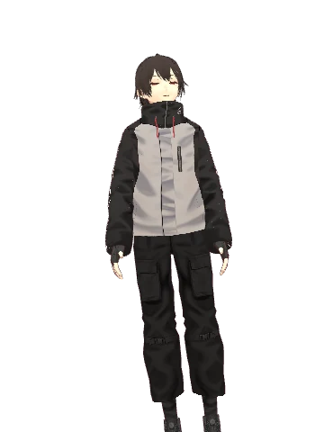
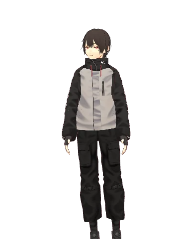
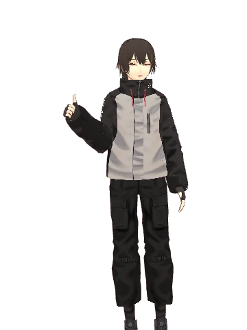
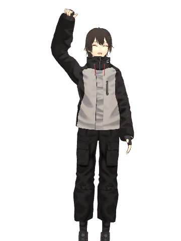

  
    
  
  
  

 

> *The website for QuestFit, a fitness RPG for Android. Live at [questfit-evj.pages.dev](https://questfit-evj.pages.dev).*

## ✦ What's on the site

<table>
  <tr>
    <td width="300" valign="top" align="center">
      
       The app video on the site
    </td>
    <td valign="top">
      <h3>⚔ A demo you scroll through</h3>
      
Scrolling plays out two weeks of a campaign on the app's real XP rules, from level 1 to 16, while JD warms up.

      <h3>➶ Try the classes and stakes</h3>
      
Pick Warrior, Ranger, Mage or All-Rounder and the quest board changes. Pick Soft, Balanced or Hardcore and see what a missed day costs.

      <h3>▶ The real app in your browser</h3>
      
"Play the real app" runs QuestFit itself with a demo hero.

      <h3>⬇ Download for Android</h3>
      
The signed APK, straight from the page.

    </td>
  </tr>
</table>

## 🌙 JD at every level

  
  
  
  

## 🛠 Built with

  
  
  
  
  

## Credits

JD uses "AvatarSample_C" by pixiv VRoid Project. The app lives at [armaanxd/questfit](https://github.com/armaanxd/questfit).

Copyright © 2026 armaanxd. All rights reserved. The code is public to view; it isn't licensed for reuse.
