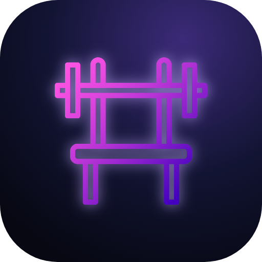
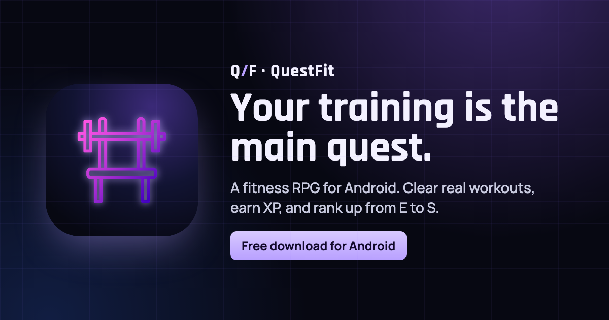

  

<h1 align="center">QuestFit website</h1>

The home of QuestFit, a fitness RPG for Android. 
<a href="https://questfit-evj.pages.dev"><b>questfit-evj.pages.dev</b></a>

  

## What's on the site

- **A live demo you scroll through.** Scrolling plays out two weeks of a campaign on the app's real XP rules, from level 1 to 16, while JD, the companion, warms up.
- **Try the classes and stakes.** Pick Warrior, Ranger, Mage or All-Rounder and the quest board changes. Pick Soft, Balanced or Hardcore and see what a missed day costs.
- **The real app in your browser.** "Play the real app" runs QuestFit itself with a demo hero.
- **Download for Android.** The signed APK, straight from the page.
- **The privacy policy** for the app.

## Built with

Plain HTML, CSS and JavaScript with no build step · Three.js and three-vrm for JD · hosted on Cloudflare Pages

## The app

The app itself lives at [armaanxd/questfit](https://github.com/armaanxd/questfit).

## Credits

JD uses "AvatarSample_C" by pixiv VRoid Project.

## Licence

Copyright © 2026 armaanxd. All rights reserved. The code is public to view; it isn't licensed for reuse.
